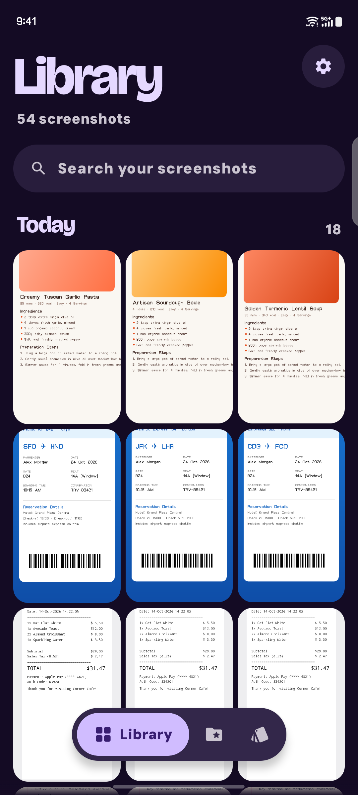
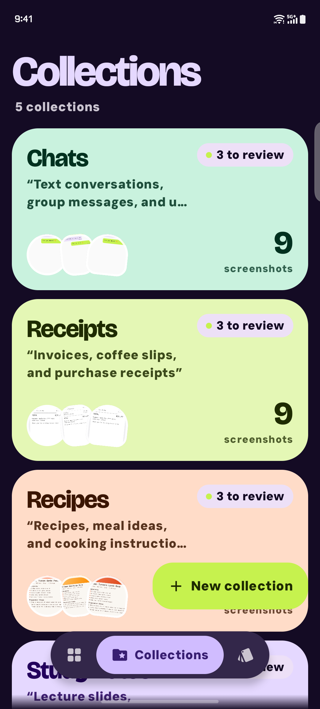
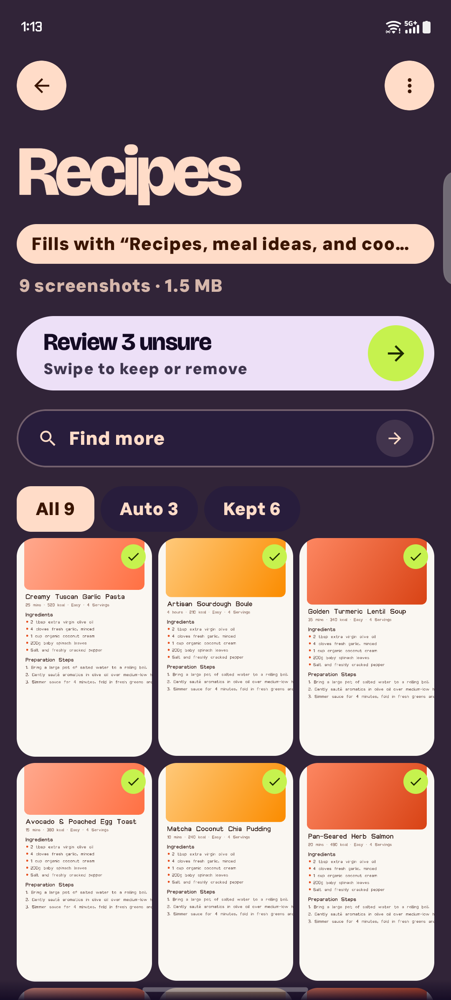
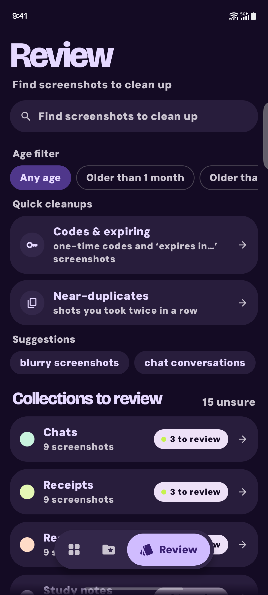
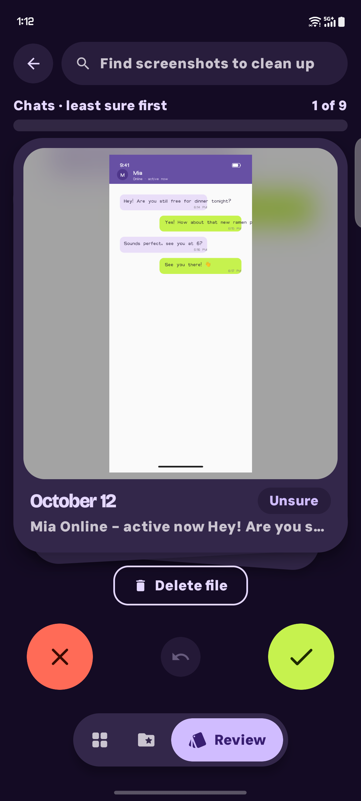

<div align="center">

# Sift

**Find, group and clean up your screenshots, with AI that runs on your phone.**

Kotlin · Jetpack Compose (Material 3 Expressive) · Room · ONNX Runtime

</div>

<p align="center">
  
  
  
  
  
</p>

Most phones end up with a thousand screenshots and no way to find the one you need. Sift reads them, lets you group them into collections you name yourself, and helps you decide what to delete.

## What it does

**Library.** Every screenshot on your phone, grouped by day, with a search bar on top. Search looks at what is on the screenshot (text and visual content), not at file names.

**Collections.** Make a collection, give it a name and a short description, and show it about ten examples. Sift fills it with the screenshots that look like them. Collections are open-ended: there is no fixed list of categories.

**Review.** Collections are never filled in silently. Screenshots Sift is unsure about show up under "N to review". You swipe to keep or remove them, and each swipe teaches that collection what belongs in it.

**Cleanup.** Review also groups the things most people want gone:
- one-time codes and "expires in…" screenshots
- near-duplicates, the shot you took twice in a row
- suggestions such as blurry screenshots and old chat conversations

Nothing is deleted without you. Every deletion goes through swipe review and the Android delete dialog.

## Screens

| Library | Collections | Collection | Review | Swipe |
|:---:|:---:|:---:|:---:|:---:|
| Browse by day, search by content | Pastel cards with counts and what is left to review | Kept vs. auto-added, one tap to review the unsure ones | Quick cleanups and collections waiting on you | Keep or remove, least sure first |

## On-device AI

Search and collections use a 316 MB embedding model that Sift downloads once and then runs locally with ONNX Runtime. Screenshots are turned into small vectors on the phone, and OCR runs on the phone too. Indexing, search and collection matching do not need a connection once the model is installed.

## Build

Requirements: Android Studio (or JDK 17 and the Android SDK), a device or emulator on API 26 or newer.

```powershell
.\gradlew.bat assembleDebug          # debug build
.\gradlew.bat testDebugUnitTest      # unit tests
```

Release builds are signed from a keystore described by `SIFT_KEYSTORE_PROPERTIES` or `~/.sift-signing/keystore.properties`. Without one, the release build is unsigned.

### Demo build

`assembleDemo` produces a separate app (`com.peexr.sift.demo`) that installs next to the real one. It ignores the screenshots on the device and shows a generated library of fictional screenshots with five collections, so it is safe to use for screenshots and videos. The README images were taken with it.

```powershell
.\gradlew.bat assembleDemo
adb install -r app\build\outputs\apk\demo\app-demo.apk
```

The demo has no search model, so search is not available in it.

## Project layout

```
app/src/main/java/com/peexr/sift/
  data/          Room database, repository, embedding engine, collection matching, cleanup rules
  ui/            Library, Collections, Review, Viewer, Settings, theme
```

Design notes and plans live in [`docs/`](docs/).
